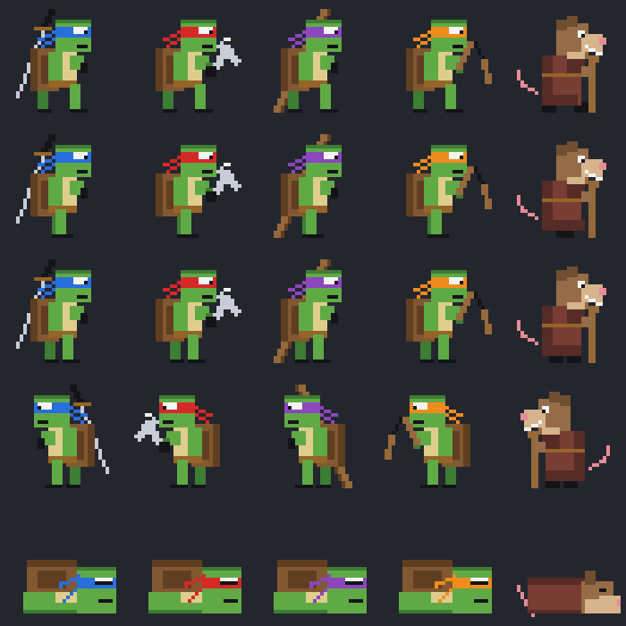

# The cast

A short guide to the five characters in this mod, for anyone who has not met
them yet.

## What is TMNT?

*Teenage Mutant Ninja Turtles* started in 1984 as an independent comic by Kevin
Eastman and Peter Laird. It began as a joke that mixed several gritty comics
of the time, and grew into cartoons, films, toys and games.

The premise: four pet turtles and their owner's rat fall into a canister of
mutagen in the New York sewers. The turtles become human-sized and the rat
becomes their teacher. He trains them in ninjutsu, they name themselves after
Renaissance painters and they keep fighting evil, most often the Foot Clan and
their leader, the Shredder. They also love pizza.

Details change between versions (comics, the 1987 cartoon, the films, the
2012 and later series). What follows is the common core.

## The brothers

Each turtle wears a colored mask and carries a different weapon. In this mod
that is the color of the mask and the weapon you see on the sprite.

### Leonardo (blue, katana)

The leader. Disciplined, serious and responsible, he trains hardest and holds
the team together, sometimes at the cost of being a bit stiff. Carries two
katana, the sprite shows one on his back.

### Raphael (red, sai)

The tough one. Hot-headed, sarcastic and fiercely loyal, he would rather act
than talk and often clashes with Leonardo. Fights with two sai, the three-pronged
daggers. Under the attitude he cares the most.

### Donatello (purple, bo staff)

The brains. A tinkerer and inventor who builds the gadgets, vehicles and
computers, and often has the plan that others lack. Fights with a long bo
staff.

### Michelangelo (orange, nunchaku)

The fun one. Easygoing, jokey and endlessly cheerful, a free spirit who keeps
the mood up and loves pizza more than anyone. Fights with nunchaku.

## The teacher

### Splinter

The rat sensei and father figure of the four. Calm, wise and patient, he
taught them ninjutsu and the values behind it. In many versions he was once a
human martial artist, Hamato Yoshi, before the mutation. He walks with a cane
and keeps a close eye on his sons.

## Who should be your agent?

Pure play, nothing in the mod depends on it. A few ways people could map them:

- **Leonardo** for the main agent that leads the work.
- **Raphael** for the one you hand the blunt, risky jobs.
- **Donatello** for the tool and infrastructure agent.
- **Michelangelo** for the one that writes docs, copy and the fun parts.
- **Splinter** for a reviewer or planner that keeps the others in line.

You pick the character per agent with a right-click, so use whatever fits.
