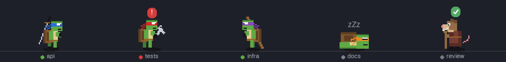

# tmnt-agents

A [Herdr](https://herdr.dev) mod: every agent is a pixel-art ninja turtle (or
their rat sensei) walking a strip at the bottom of the window. Working agents
walk, idle ones stroll and nap, blocked ones stop and call for you. Click a
character to jump to its agent, right-click to choose who it is.



*An illustration of the strip, drawn from the real sprites: working, blocked, sleeping and done agents.*

The cast is Leonardo, Raphael, Donatello, Michelangelo and Splinter. Who they
are is in [CHARACTERS.md](CHARACTERS.md).

## Install

Ask your agent: *"add the Herdr mod at github.com/barisgunduz/tmnt-agents"*.
Or by hand:

```sh
cp -r mods/tmnt-agents ~/.config/herdr-app/mods/
herdr-app check ~/.config/herdr-app/mods/tmnt-agents
```

Then add the layout block from [RECIPE.md](RECIPE.md) and, if you want the
shortcut, merge [keys.json](keys.json).

There is nothing else to install. The art ships inside the mod, so it needs no
network, no `curl` and no ImageMagick.

## What you see

- **One strip, 112 px tall**, full width, with a thin ground line near the
  bottom. Every agent is one character standing on it, with a soft shadow.
- **A name tag** under each character: a dot in the agent's status color and
  the tab's name (or the space's name). Hover to see `<character> · <tag>`.
  Tags never overlap, the one that matters most stays.
- **A bubble above the head**: a pulsing `!` when blocked, a `✓` when done,
  and `z`, `zZ`, `zZz` while asleep.
- **A pizza slice** pulses in place of a character while its art loads.
  You will rarely catch it, the art is local.
- **No agents**: a short hint is shown instead.

## How it behaves

- **working**: walks. Picks a random spot at least 60 px away, faces that way,
  walks there at 70 px/s, pauses a moment and repeats.
- **idle**: strolls slowly with long pauses. After 3 minutes without a change
  in its tab it lies down and sleeps.
- **blocked**: stops where it is and shows `!`. Its tag wins over its
  neighbors.
- **done**: stops and shows `✓`. Herdr turns `done` into `idle` once you look
  at the tab.
- **Click**: shows that agent's tab and pane.
- **Right-click**: opens the picker. Click a hero to choose, Esc closes. The
  choice is saved per pane, so it survives restarts.
- **New agents** get a character nobody on screen has yet, picked from a hash
  of their pane id. With more than five agents, characters repeat.
- **Key** (optional): `alt-shift-t` opens the picker for the focused agent.

## Scale

Set `content.props.scale` to a positive number (`1` by default) to resize the
characters. See [RECIPE.md](RECIPE.md).

## Making your own art

Every sprite is drawn by code, not exported from anywhere. To change a
character, edit `tools/make_sprites.py` and run:

```sh
python3 tools/make_sprites.py
```

It needs Python 3 and [Pillow](https://python-pillow.org). It rewrites the GIFs,
the picker icons, the pizza, `preview.png` and `characters.png`. Characters are drawn facing
right on a 32x32 grid, mirrored for left and scaled 2x with nearest neighbor.

## Tested on

macOS with Herdr app 0.1.16.

## Credits

The strip layout, the mood logic and the picker follow
[herdr-pokemon-agents](https://github.com/mathieucroset/herdr-pokemon-agents)
by Mathieu Croset (MIT). This mod swaps the art and the character set and
drops the download step. All sprites here are original pixel art made for this
project.

## Disclaimer

This is an unofficial fan project. Teenage Mutant Ninja Turtles and its
characters were created by Kevin Eastman and Peter Laird and are owned by
Paramount, through Nickelodeon. This project is not affiliated with or
endorsed by them, and it is free and non-commercial. The code is MIT licensed, see [LICENSE](LICENSE).
That license covers the code and the original artwork in this repo, not the
characters themselves.
